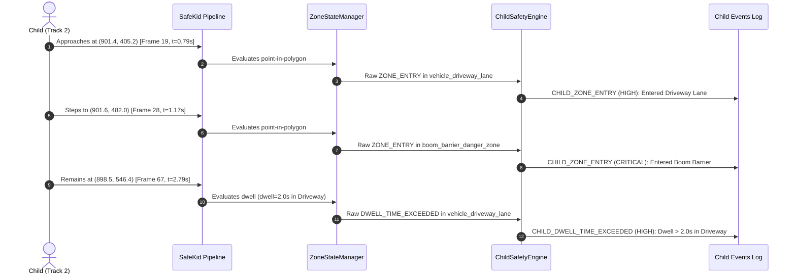

# SafeKid AI — Overlapping Zone & Alert Correlation Audit

**Document ID:** `AUDIT-12-ALERT-CORRELATION`  
**Execution Timestamp:** `2026-11-04 10:15:00 UTC`  
**Audited Scenario:** Scenario C — Boom Barrier (`data/demo/boom_barrier_demo.mp4`)  
**Audited Configuration:** `configs/cameras/community_001/camera_gate_north.json`  
**Audited Event Logs:**
- `outputs/boom_barrier_events.json`
- `outputs/boom_barrier_child_events.json`

---

## 1. Executive Summary

In gated residential communities, physical safety hazards are frequently nested or spatially adjacent. A primary example is a community vehicular entrance: a designated roadway or driveway encompasses automated mechanical boom barriers, tire shredders, or security turnstiles.

This audit inspects how **SafeKid AI** currently evaluates overlapping and nested Regions of Interest (ROIs), assesses whether the current multi-alert behavior is desirable or risks alert fatigue, evaluates severity prioritization, and presents an architectural design for downstream **Alert Correlation and Incident Aggregation** that preserves raw event logs.

---

## 2. Geometric Nesting in `camera_gate_north.json`

The camera configuration `configs/cameras/community_001/camera_gate_north.json` defines three zones:

```
+------------------------------------------------------------------------+
| Dedicated Pedestrian Sidewalk (SAFE)                                   |
| [80, 450] -> [420, 450] -> [360, 1050] -> [50, 1050]                   |
+------------------------------------------------------------------------+
| Main Vehicular Driveway (DANGER, Severity: HIGH)                       |
| [500, 400] -> [1350, 410] -> [1500, 1050] -> [380, 1050]               |
|                                                                        |
|      +----------------------------------------------------------+      |
|      | Boom Barrier Mechanical Zone (DANGER, Severity: CRITICAL)|      |
|      | [720, 480] -> [1080, 480] -> [1100, 620] -> [700, 620]   |      |
|      +----------------------------------------------------------+      |
|                                                                        |
+------------------------------------------------------------------------+
```

### Geometric Verification:
- **Parent Zone (`vehicle_driveway_lane`):**
  - X-bounds: $380.0 \text{ px}$ to $1500.0 \text{ px}$
  - Y-bounds: $400.0 \text{ px}$ to $1050.0 \text{ px}$
- **Child Zone (`boom_barrier_danger_zone`):**
  - X-bounds: $700.0 \text{ px}$ to $1100.0 \text{ px}$
  - Y-bounds: $480.0 \text{ px}$ to $620.0 \text{ px}$
- **Containment Relationship:**
  $\text{polygon}(\text{boom\_barrier\_danger\_zone}) \subset \text{polygon}(\text{vehicle\_driveway\_lane})$.
  Any person standing inside the boom barrier zone is **geometrically guaranteed** to be simultaneously inside the vehicular driveway.

---

## 3. Observed Pipeline Behavior in Scenario C

When Track 2 (Child) approaches from the north and steps into the barrier area:



### Event Manifest:
1. **Frame 19 ($t = 0.792\text{ s}$):** `CHILD_ZONE_ENTRY` for `vehicle_driveway_lane` (Severity: `HIGH`).
2. **Frame 28 ($t = 1.167\text{ s}$):** `CHILD_ZONE_ENTRY` for `boom_barrier_danger_zone` (Severity: `CRITICAL`).
3. **Frame 67 ($t = 2.792\text{ s}$):** `CHILD_DWELL_TIME_EXCEEDED` for `vehicle_driveway_lane` (Severity: `HIGH`).

---

## 4. Operational Analysis: Distinct Hazards vs. Alert Fatigue

### The Case for Independent Alerts (Engineering & Forensics):
- The hazards are physically and legally distinct:
  - **Driveway Hazard:** Collision risk with oncoming motor vehicles moving at 15–30 km/h.
  - **Boom Barrier Hazard:** Mechanical entrapment, descending barrier arm impact, or motorized pinch injury.
- For insurance investigations, litigation defense, and audit trails, the system must prove that it detected *both* the vehicle roadway breach and the mechanical barrier breach.

### The Problem with Uncorrelated Alerts (Security Operations):
- **Notification Burst:** Within 375 milliseconds, security staff receive two audible alerts of differing severities for the exact same child.
- **Cognitive Confusion:** If a security guard checks their mobile dispatch console, they see:
  - Alert 1: "Child entered Driveway [HIGH]"
  - Alert 2: "Child entered Boom Barrier [CRITICAL]"
  - Alert 3: "Child dwelling in Driveway [HIGH]" (at $t = 2.79\text{ s}$)
- **The Inverted Dwell Problem:** At $t = 2.79\text{ s}$, the child is standing directly under the boom barrier arm. Yet the alert received by the guard states that the child is "dwelling in the driveway" (because `boom_barrier_danger_zone` has `dwell_alert=False` while `vehicle_driveway_lane` has `dwell_alert=True`). The lower-severity alert fires while the child is engaged in a higher-severity hazard.

---

## 5. Architectural Solution: Clean Alert Correlation Engine

To resolve alert fatigue without losing raw forensic precision, SafeKid AI requires an **Alert Correlation and Incident Aggregator Layer** positioned downstream of `ChildSafetyEventEngine`.

### Core Architectural Rule:
> **The raw event stream must remain immutable.** Raw `SafetyEvent` and `ChildSafetyEvent` logs must never be suppressed, merged, or discarded. Correlation is an **outbound dispatch service**, not an in-engine mutator.

```
+-----------------------------------------------------------------------------+
|                           Raw Pipeline State                                |
|  ZoneStateManager -> ChildSafetyEventEngine -> Immutable Event JSON Log     |
+-----------------------------------------------------------------------------+
                                      |
                                      v
+-----------------------------------------------------------------------------+
|                    Dispatch AlertCorrelationEngine                          |
|  - Tracks Active Incidents per Track ID                                     |
|  - Evaluates Spatial Containment & Severity Dominance                       |
|  - Groups Multi-Zone Entries into a Single Unified Incident                 |
|  - Manages Escalation Lifecycle (OPEN -> ESCALATED -> RESOLVED)             |
+-----------------------------------------------------------------------------+
                                      |
                                      v
+-----------------------------------------------------------------------------+
|                     Security Console / Mobile Dispatch                      |
|  "INCIDENT #104: Child (Track 2) in BOOM BARRIER DANGER ZONE                |
|   Nested in: Main Driveway | Severity: CRITICAL | Status: ESCALATED"        |
+-----------------------------------------------------------------------------+
```

### Proposed Correlation Rules:

1. **Spatial Nesting Escalation:**
   If zone $B$ is completely enclosed within zone $A$, and Track $T$ is already in an open incident for $A$:
   - An entry into $B$ **escalates** the existing incident to $\max(\text{sev}(A), \text{sev}(B))$ rather than generating a secondary ticket.
   - Dispatch message: `"INCIDENT ESCALATED: Child (Track 2) moved from Main Driveway into BOOM BARRIER ZONE [CRITICAL]"`.

2. **Dwell Roll-Up & Suppression:**
   If a child is inside nested zone $B$ (which has `CRITICAL` severity), dwell alerts from parent zone $A$ (`HIGH`) are suppressed from the primary dispatch notification and appended to the incident's audit log.

3. **Unified Incident Lifecycle:**
   - **`OPEN`:** Triggered when the child first enters any danger zone.
   - **`ESCALATED`:** Triggered if the child transitions to a higher-severity nested or adjacent danger zone.
   - **`DE-ESCALATED`:** Triggered if the child exits a nested zone but remains in the parent zone.
   - **`RESOLVED`:** Triggered only when the child has confirmed exit from *all* active danger zones.

This design provides zero alert fatigue for security personnel while preserving 100% forensic data integrity.

