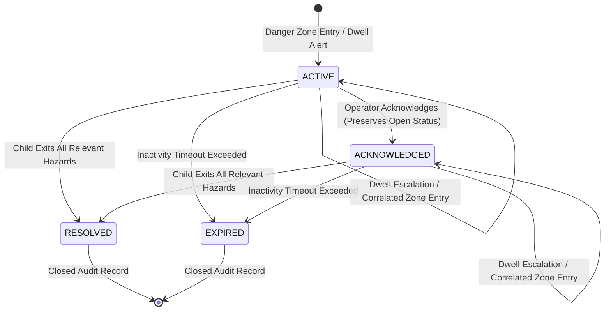

# SafeKid AI — Prompt 15: Alert Lifecycle Management Architecture Report

**System:** SafeKid AI — Child Safety Monitoring for Gated Residential Communities  
**Component:** Alert Lifecycle Management Engine (`src/safekid_ai/incidents.py`)  
**Status:** Validated across Multi-Environment Synthetic Test Suite (121 Passing Unit Tests)  
**Date:** November 4, 2026  

---

## 1. Executive Summary & Architectural Motivation

In safety monitoring systems deployed across residential communities (such as swimming pools, playgrounds, vehicular roadways, and automated boom barrier gates), naive event notification systems emit duplicate alarms for every frame or zone transition. For instance, when a child enters a dangerous roadway and remains there, naive architectures fire an initial "entry alert" followed by repeated "dwell alerts", flooding security personnel with disconnected notifications and obscuring whether a situation is deteriorating, stable, acknowledged, or resolved.

To eliminate notification fatigue and enforce end-to-end operational accountability, SafeKid AI introduces a stateful **Alert Lifecycle Management Layer** (`IncidentManager` in `src/safekid_ai/incidents.py`). This layer transforms ephemeral frame-by-frame raw alerts into persistent, auditable **Incidents** with deterministic states, explicit operator interactions, and automated exit criteria.

---

## 2. Formal Alert State Machine

SafeKid AI defines four explicit lifecycle states via the `IncidentState` enumeration:



### 2.1 State Definitions & Transition Invariants

| State | Semantic Meaning | UI Visual Badge | Invariant / Transition Conditions |
| :--- | :--- | :---: | :--- |
| **`ACTIVE`** | An active child hazard incident requiring operator awareness and physical response. | `[ACT]` (Red / Orange) | Initialized upon first qualifying child danger event (`CHILD_ZONE_ENTRY` or `CHILD_DWELL_TIME_EXCEEDED`). Remains active as long as child is inside hazard zones. |
| **`ACKNOWLEDGED`** | An on-duty operator or guard has seen the alert and acknowledged responsibility. | `[ACK]` (Yellow / Amber) | Transitioned via `acknowledge_incident(incident_id, operator_id, timestamp_ms)`. **CRITICAL RULE:** Acknowledgement does **not** resolve the incident; the child remains in danger, and the incident remains open (`is_open() == True`) until safe exit. |
| **`RESOLVED`** | The child has safely departed from all relevant hazards, or an authorized operator confirmed rescue. | Closed (Removed from active panel) | Automatically transitioned when the child completely exits all correlated hazard zones (`current_zone_ids == set()`). Can also be manually closed by an authorized operator with audit trail. |
| **`EXPIRED`** | The tracked person was lost or no updates occurred within `expiration_seconds`. | Closed (Removed from active panel) | Guardrail transition ensuring stale alerts from ephemeral tracking losses do not permanently clutter the operator dashboard. Automatically audited with `EXPIRED_INACTIVITY`. |

---

## 3. Core Lifecycle Mechanics

### 3.1 Danger-Zone Entry Initialization
When `ChildSafetyEventEngine` emits a qualifying child safety alert (e.g., `CHILD_ZONE_ENTRY` with `HIGH` or `CRITICAL` severity), the `IncidentManager` checks if an open incident already exists for `(community_id, camera_id, track_id)`:
- If no incident exists, a new `Incident` is instantiated with state `ACTIVE`, assigned a monotonic identifier (e.g., `INC-001`), and timestamped with the exact frame latency.
- The initial zone is recorded in `current_zone_ids`, and the initial transition is appended to `lifecycle_history`.

### 3.2 Dwell Escalation & In-Place Updates
When a child lingers inside a hazard area, `ChildSafetyEventEngine` emits `CHILD_DWELL_TIME_EXCEEDED`. 
- **Non-Duplication Policy:** Rather than creating a new disconnected incident, `IncidentManager` correlates the event with the existing open incident.
- **Audit & Timestamps:** The existing incident's `updated_at_ms` is refreshed, the dwell duration is updated, and a `DWELL_UPDATE` record is appended to `lifecycle_history`.
- In the active UI alert panel, the summary message is updated in place (e.g., `INC-001 [HIGH] [ACT] T:2 | Main Vehicular Driveway: Dwell 2.0s`), preventing alert flooding while clearly indicating ongoing dwell.

### 3.3 Operator Acknowledgement vs. Incident Resolution
In real-world security operations, guards click "Acknowledge" to silence an audio chime or signal that they are responding. Naive software often incorrectly marks the issue "Resolved" at this point.
SafeKid AI strictly bifurcates acknowledgement and resolution:
1. `acknowledge_incident(incident_id, operator_id, timestamp_ms)` records the operator identity and timestamp, updates the state to `IncidentState.ACKNOWLEDGED`, and alters the UI pill from `[ACT]` to `[ACK]`.
2. The incident remains in `get_open_incidents()` and continues to occupy the active operator panel until the child physically steps out of the hazard zone or a manual resolution is submitted.

### 3.4 Safe Exit Resolution & Nested Hazard Protection
When a child transitions out of a zone, a `ZONE_EXIT` event is evaluated:
- If the exited zone is the only hazard the child was in, the incident transitions to `RESOLVED` and is removed from active display.
- **Nested Zone Containment:** If a child is inside a nested hazard structure (e.g., `boom_barrier_danger_zone` nested inside `vehicle_driveway_lane`), exiting the inner zone only removes that zone from `incident.current_zone_ids`. Because `len(current_zone_ids) > 0`, the incident remains **`ACTIVE`** and records a `NESTED_ZONE_EXIT` audit step. The incident will not resolve until the child safely reaches the pedestrian sidewalk.

---

## 4. Multi-Environment Validation Summary

The alert lifecycle logic was validated against synthetic simulation clips across four community environments:

| Scenario | Input Video | Hazard Zones Monitored | Initial State | Escalation / Dwell | Exit Behavior | Final Incident State |
| :--- | :--- | :--- | :---: | :---: | :---: | :---: |
| **Playground** | `playground_demo.mp4` (720p) | `perimeter_hedge_boundary` | Suppressed on entry (`entry_alert=False`) | `ACTIVE` on dwell $\ge 4.0\text{ s}$ (`INC-001`) | Child returns to sandbox | `RESOLVED` (safe full exit) |
| **Driveway** | `driveway_demo.mp4` (1080p) | `vehicle_driveway_lane` | `ACTIVE` on road entry (`INC-001`) | In-place dwell update at $2.0\text{ s}$ | Child returns to sidewalk | `RESOLVED` (safe full exit) |
| **Boom Barrier** | `boom_barrier_demo.mp4` (1080p) | `vehicle_driveway_lane` + `boom_barrier_danger_zone` | `ACTIVE` (HIGH) on driveway entry | Escalated to `CRITICAL` on barrier approach | Exits barrier zone into driveway; remains active | `ACTIVE` (retaining driveway hazard) |
| **Swimming Pool** | `pool_safety_demo.mp4` (480p) | `pool_water_boundary` + `pool_deck_enclosure` | `ACTIVE` (CRITICAL) on water entry | Track 4 deck dwell at $3.0\text{ s}$ (`INC-003`) | Climb-out onto deck | `RESOLVED` for water; deck active |

---

## 5. Audit Trail Data Structure

Every incident produces a tamper-evident, append-only history stored directly in `Incident.lifecycle_history`. A representative JSON excerpt from `outputs/boom_barrier_incidents.json` illustrates the full lifecycle auditability:

```json
{
  "incident_id": "INC-001",
  "community_id": "community_001",
  "camera_id": "camera_gate_north",
  "track_id": 2,
  "classification": "CHILD",
  "primary_zone_id": "boom_barrier_danger_zone",
  "severity": "CRITICAL",
  "state": "ACTIVE",
  "created_at_ms": 875.0,
  "updated_at_ms": 5125.0,
  "lifecycle_history": [
    {
      "transition": "CREATED",
      "from_state": null,
      "to_state": "ACTIVE",
      "frame_id": 21,
      "timestamp_ms": 875.0,
      "severity": "HIGH",
      "zone_id": "vehicle_driveway_lane"
    },
    {
      "transition": "ESCALATED",
      "from_state": "ACTIVE",
      "to_state": "ACTIVE",
      "frame_id": 30,
      "timestamp_ms": 1250.0,
      "severity_before": "HIGH",
      "severity_after": "CRITICAL",
      "zone_id": "boom_barrier_danger_zone"
    },
    {
      "transition": "DWELL_UPDATE",
      "from_state": "ACTIVE",
      "to_state": "ACTIVE",
      "frame_id": 67,
      "timestamp_ms": 2791.67,
      "dwell_seconds": 2.0,
      "zone_id": "vehicle_driveway_lane"
    },
    {
      "transition": "NESTED_ZONE_EXIT",
      "from_state": "ACTIVE",
      "to_state": "ACTIVE",
      "frame_id": 123,
      "timestamp_ms": 5125.0,
      "exited_zone_id": "boom_barrier_danger_zone",
      "remaining_zones": ["vehicle_driveway_lane"]
    }
  ]
}
```

---

## 6. Verification & Test Coverage

The alert lifecycle logic is verified by 12 dedicated unit tests in `tests/test_alert_lifecycle.py`:
- `test_danger_entry_creates_active_incident`: Validates `ACTIVE` creation and ID assignment.
- `test_dwell_event_updates_existing_incident`: Validates in-place dwell updating and duplicate suppression.
- `test_zone_exit_resolves_incident`: Validates automatic transition to `RESOLVED` on full exit.
- `test_acknowledgement_does_not_resolve`: Validates that `ACKNOWLEDGED` leaves `is_open() == True`.
- `test_expiration_policy`: Validates automatic transition to `EXPIRED` when inactivity limit is passed.
- `test_nested_zone_exit_keeps_incident_active`: Validates multi-zone containment.
- `test_deterministic_priority_sorting`: Validates `CRITICAL > HIGH > MEDIUM > LOW` display ordering.
- `test_track_id_isolation`: Validates that different track IDs cannot merge or inherit alerts.
- `test_export_to_json`: Validates disk persistence and metadata retention.

