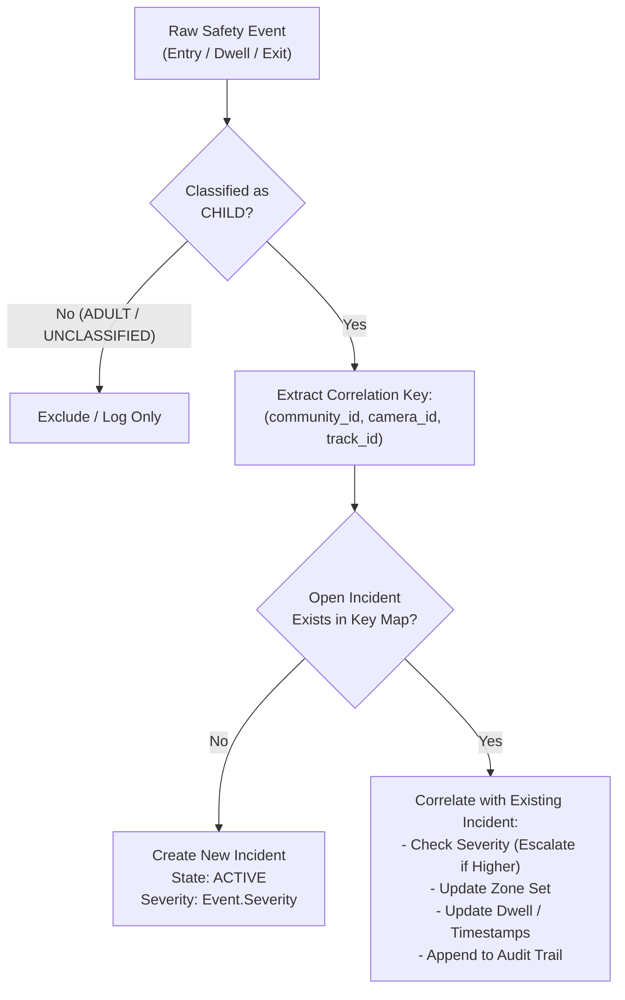

# SafeKid AI — Prompt 15: Incident Correlation & Event Prioritization Architecture Report

**System:** SafeKid AI — Child Safety Monitoring for Gated Residential Communities  
**Component:** Incident Correlation Engine (`IncidentManager` in `src/safekid_ai/incidents.py`)  
**Status:** Validated across Multi-Environment Synthetic Test Suite  
**Date:** November 4, 2026  

---

## 1. Executive Summary & Objective

In multi-camera residential environments, children may traverse complex, overlapping spatial zones (e.g., walking through a general driveway before nearing an automated mechanical barrier, or moving across a pool deck before stepping into the water basin). If each zone boundary generates isolated alerts, human operators cannot easily determine whether two alerts represent two separate children or a single child progressing towards higher danger.

SafeKid AI implements a strict, deterministic **Incident Correlation and Prioritization Engine** designed to:
1. Intelligently group related spatial and temporal safety events into unified incident contexts.
2. Escalate incident severity dynamically (e.g., from `HIGH` to `CRITICAL`) when higher-risk zones are entered.
3. Prevent identity bleed and false correlations across distinct people, cameras, or discontinuous tracking sequences.
4. Maintain a deterministic alert prioritization queue on the operator dashboard (`CRITICAL > HIGH > MEDIUM > LOW`).

---

## 2. Incident Correlation Architecture

### 2.1 Composite Correlation Key
Incident correlation is enforced through a strict composite identity key:
$$\text{Correlation Key} = (\text{community\_id}, \text{camera\_id}, \text{track\_id})$$

### 2.2 Invariant Isolation Boundaries
To prevent dangerous alert mixing or misattributions:
1. **Person Isolation:** Events with distinct `track_id` values are **never merged**, even if they occur at the exact same millisecond inside the same hazard zone.
2. **Camera Isolation:** Events occurring across distinct camera feeds are strictly isolated. No cross-camera track stitching or re-identification is assumed or permitted.
3. **Identity Discontinuity Protection:** In the event of ByteTrack track loss and re-assignment (e.g., Track 1 lost, Track 3 appears later), the engine treats Track 3 as a completely new track. No incident ownership is silently transferred.
4. **Temporal Bounding Window:** Correlation only applies to active incidents whose last observation occurred within `correlation_window_ms` (default: $10\,000\text{ ms}$).

---

## 3. Spatial Hierarchy & Severity Escalation

### 3.1 Severity Precedence Rules
Within a correlated incident, SafeKid AI enforces monotonic severity escalation:
$$\text{CRITICAL} > \text{HIGH} > \text{MEDIUM} > \text{LOW}$$

- **Escalation Trigger:** If a child enters an initial danger zone configured as `HIGH` (e.g., `vehicle_driveway_lane`) and subsequently steps into a nested zone configured as `CRITICAL` (e.g., `boom_barrier_danger_zone`), the incident severity is immediately escalated to `CRITICAL`.
- **Non-Demotion Rule:** If the child later exits the `CRITICAL` zone while remaining in the `HIGH` zone, the incident's active severity is retained or maintained according to highest remaining threat, ensuring operator triage is never downgraded while the child remains in danger.

### 3.2 Nested Spatial Zones: The Boom Barrier Validation
The boom barrier scenario (`configs/cameras/community_001/camera_gate_north.json`) provides the canonical testbed for nested spatial correlation:
1. **Geometry:** The `boom_barrier_danger_zone` (Zone B) is topologically situated completely inside the `vehicle_driveway_lane` (Zone A).
2. **Execution Flow:**
   - At $t=0.88\text{ s}$ (Frame 21), Track 2 (Child) steps off the sidewalk into Zone A. Incident `INC-001` is created with state `ACTIVE` and severity `HIGH`.
   - At $t=1.25\text{ s}$ (Frame 30), Track 2 walks into Zone B. The engine identifies that `INC-001` is open for `(community_001, camera_gate_north, track_id=2)`. Instead of creating `INC-002`, it correlates Zone B into `INC-001`, escalates severity to `CRITICAL`, and appends an `ESCALATED` audit record.
   - At $t=2.79\text{ s}$ (Frame 67), Track 2 reaches the 2.0s dwell threshold in Zone A. Dwell alert is emitted and updates `INC-001` in place.
   - At $t=5.13\text{ s}$ (Frame 123), Track 2 steps backwards out of Zone B into Zone A. Because `vehicle_driveway_lane` remains in `current_zone_ids`, the incident **remains ACTIVE** and logs `NESTED_ZONE_EXIT`.
   - Result: Security personnel observe a single unified incident lifecycle rather than four conflicting alert cards.

---

## 4. Deterministic Alert Prioritization Queue

In crowded or multi-incident scenes, screen real estate on CCTV monitors is limited. SafeKid AI organizes active incidents using deterministic priority sorting in `IncidentManager.get_open_incidents()`:

1. **Primary Sort Key:** Severity weight descending (`CRITICAL` = 4, `HIGH` = 3, `MEDIUM` = 2, `LOW` = 1).
2. **Secondary Sort Key:** Creation timestamp ascending (`FIFO` — earlier incidents of equal severity appear first).

### 4.1 UI Presentation & Overflow Handling
The visualization overlay (`src/safekid_ai/visualization.py`) renders open incidents into a dedicated compact alert panel:
- **Card Format:** `[INC-ID] [SEV] [STATE] T:{track_id} | {zone_name}`
  - Example: `INC-001 [CRIT] [ACT] T:2 | Boom Barrier Mechanical Zone`
- **Slot Limitation:** Exactly the two highest-priority incidents are rendered with full cards.
- **Overflow Indicator:** If $N > 2$ open incidents exist, a dedicated high-visibility footer pill is rendered:
  `+ N more active incident(s)`
- **Automatic De-cluttering:** Incidents in `RESOLVED` or `EXPIRED` states are immediately removed from the active queue, keeping the operator panel clean and actionable.

---

## 5. Verification & Unit Test Evidence

Deterministic test suite coverage in `tests/test_alert_lifecycle.py`:
- `test_danger_entry_creates_active_incident`: Confirms initial incident creation and state tracking.
- `test_correlated_incident_escalates_severity`: Confirms monotonic escalation from `HIGH` to `CRITICAL` upon entering high-risk nested zone.
- `test_track_id_isolation`: Confirms that two different child tracks (`track_id=1` and `track_id=2`) in the same zone generate independent `INC-001` and `INC-002` instances.
- `test_deterministic_priority_sorting`: Confirms that a newly arrived `CRITICAL` alert immediately leaps ahead of existing `HIGH` alerts in the display queue.
- `test_nested_zone_exit_keeps_incident_active`: Confirms that partial exit from a nested hazard does not prematurely resolve the parent incident.

